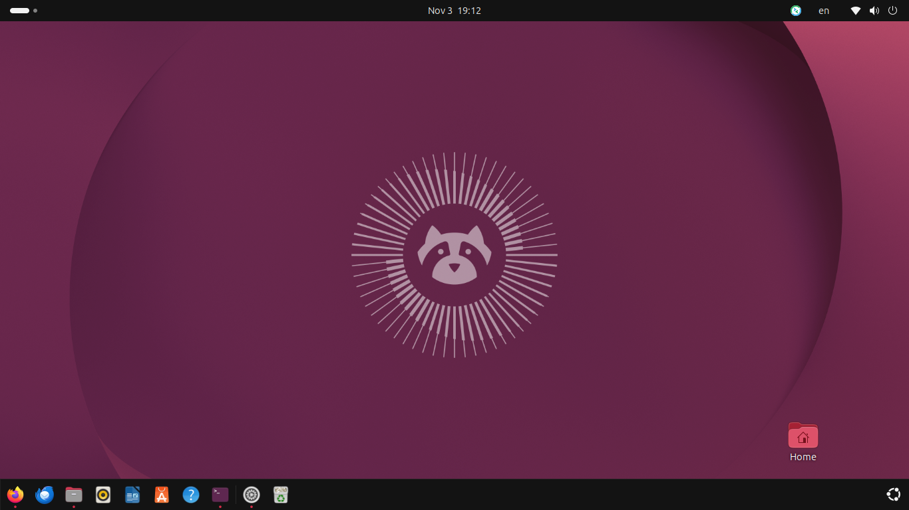

# CyberSecuriry-home-lab
# Cybersecurity Home Lab 🐧

## About This Project

This repository documents my journey of building a personal cybersecurity home lab and developing practical IT infrastructure skills.

## Week 1: Linux Setup & Troubleshooting

This week focused on preparing my environment for cybersecurity practice.

### Tasks Completed

- Troubleshot Windows installation issues.
- Switched to Ubuntu Linux.
- Created bootable USB drives.
- Investigated USB flash drive errors and bad sectors.
- Verified Linux ISO integrity using SHA256 checksums.
- Troubleshot boot and installation errors.
- Installed VirtualBox.
- Successfully installed Kali Linux in a virtual machine.

### Tools & Technologies

- Ubuntu Linux
- Kali Linux
- VirtualBox
- SHA256 / sha256sum
- USB Bootable Media
  
  ## Screenshots

### Ubuntu Environment

### Kali Linux

### VirtualBox

### Challenges & Lessons Learned

Faced several installation failures, USB hardware issues, and unexpected power interruptions.

These challenges helped me improve my troubleshooting, problem-solving, and Linux installation skills.

## Upcoming Tasks

- [ ] Install and configure a firewall (pfSense/OPNsense).
- [ ] Set up a Windows virtual machine.
- [ ] Configure an isolated virtual network.
- [ ] Practice network scanning using Nmap.
- [ ] Analyze network traffic using Wireshark.

**Status:** In Progress 🚀
